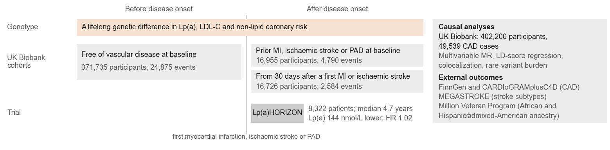
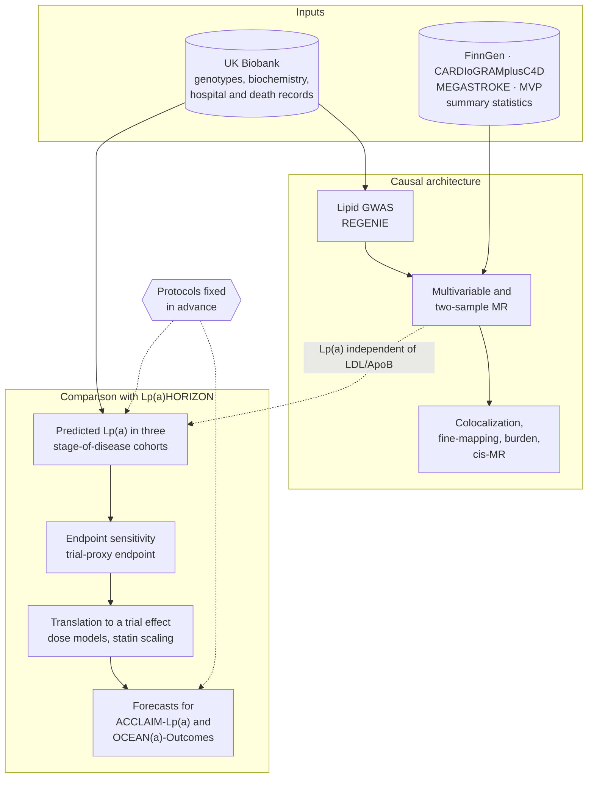

<div align="center">

# Lipoprotein(a) genetic risk after disease onset, and what it implies for trials

**Analysis code, protocol documents and summary-level results for a UK Biobank study of the LDL/ApoB and lipoprotein(a)
axes of coronary artery disease**

[](https://doi.org/10.5281/zenodo.21285448)
[](LICENSE)
[](CHANGELOG.md)


</div>

<p align="center">
  
</p>

Code for *Lipoprotein(a) genetic risk persists after disease onset but does not reliably predict trial benefit* (Pandey and
Narasimhan; manuscript in submission). The figure above is panel a of the paper's Fig. 1, drawn by the paper's own figure
code (`scripts/figures_nature/make_readme_figure.py`).

## The question

Human genetics made lipoprotein(a) [Lp(a)] a drug target. Yet in Lp(a)HORIZON, the first outcomes trial of Lp(a) lowering,
pelacarsen did not reduce cardiovascular events (hazard ratio 1.02). Genetic estimates describe a lifelong difference,
mostly before a first event, whereas the trial treated established disease for a few years. This repository holds the
code that asks three things of the genetic evidence:

1. **Does the Lp(a) association persist after disease onset?** It compares genetically predicted Lp(a) across three
   cohorts defined by stage of disease, against a positive-control LDL-C score, under a protocol fixed in advance.
2. **How does the implied trial effect depend on endpoint and dose assumptions?** It covers the trial-proxy endpoint, the
   statin scaling and the dose models.
3. **What does the evidence forecast for the two trials still running?** These forecasts were committed before their
   models were fitted.

It also holds the causal analyses that place Lp(a) beside the LDL/ApoB axis: multivariable and two-sample Mendelian
randomization, stroke subtypes, statin interaction, colocalization, fine-mapping, rare-variant burden and drug-target
*cis*-MR.

## What the paper finds

Hazard ratios (HR) are per 144 nmol/L lower genetically predicted Lp(a), the between-arm difference in Lp(a)HORIZON, with
95% confidence intervals.

| Question | Finding |
|---|---|
| Does the association persist after disease onset? | **Yes, in part.** HR 0.74 (0.71–0.77) before a first event and 0.84 (0.79–0.90) in participants with established disease at baseline: 58% (35–81%) of the log-HR association retained, against 74% for the positive-control LDL-C score |
| Does it depend on which events are counted? | **Yes.** In participants followed from 30 days after a first event, 0.88 (0.80–0.96) with any revascularization but 0.96 (0.87–1.07) on a trial-proxy endpoint that counts only revascularizations with an acute coronary diagnosis |
| Does its size predict the trial? | **Not reliably.** One dose slope implies 0.87 (0.80–0.94) on the trial-proxy endpoint against the observed 1.02 (0.90–1.15). A second slope above 150 nmol/L, fitted to 1,274 participants, implies 0.92 (0.80–1.05), and the difference is inconclusive |
| Is Lp(a) a target in its own right? | **Yes.** Coronary artery disease odds ratio 1.16 (1.13–1.20) per SD with ApoB held fixed, and 1.16 (1.10–1.22) against FinnGen; 1.25 (1.22–1.28) against CARDIoGRAMplusC4D on a *cis*-*LPA* instrument |

## At a glance

| | |
|---|---|
| **Discovery cohort** | 402,200 unrelated European-ancestry UK Biobank participants |
| **External outcomes** | FinnGen, CARDIoGRAMplusC4D, MEGASTROKE, Million Veteran Program |
| **Fixed in advance** | Protocol and decision rule of the trial comparison; the forecasts and the rules for judging them. Every later analysis is labelled post hoc, with the date it was declared ([protocols/](protocols/README.md)) |
| **Data here** | Code and summary-level tables only. No individual-level data, no identifiers, no count of one to four people |
| **Reproducibility** | An md5 for every file ([CODE_MD5.tsv](CODE_MD5.tsv)); the output behind 41 of the 51 published tables ([TABLE_SOURCES.tsv](TABLE_SOURCES.tsv)); synthetic self-tests; figures that redraw byte-identically from summary tables |

## How the analyses fit together



## Forecasts on record

The paper commits forecasts for two trials of near-complete Lp(a) lowering that have not yet reported. They are
**conditional scenarios, not predictions of the trials' results**. Each rests on a dose model and an assumed 90% lowering,
at Lp(a) concentrations few UK Biobank participants reach. Hazard ratio for the primary endpoint (95% interval of 20,000
coefficient draws):

| Trial and population | One dose slope | Second slope above 150 nmol/L |
|---|---|---|
| ACCLAIM-Lp(a) (NCT06292013), at risk of a first event | 0.68 (0.59–0.78) | 0.67 (0.53–0.86) |
| ACCLAIM-Lp(a), established disease | 0.77 (0.70–0.84) | 0.84 (0.74–0.97) |
| OCEAN(a)-Outcomes (NCT05581303), coronary composite | 0.71 (0.62–0.80) | 0.81 (0.65–1.02) |

**Primary forecast.** The established-disease log hazard ratio in ACCLAIM-Lp(a) is forecast as a share of the at-risk one:
0.69 (0.40–1.16), imprecise.

The rules for judging the forecasts are in
[`FORECAST_PREREGISTRATION.md`](scripts/agent1_genetics/lpa_horizon/FORECAST_PREREGISTRATION.md), and every estimate is in
[`results_summary/lpa_horizon/forecast/`](results_summary/lpa_horizon/forecast). A commit date is not a public timestamp:
the forecasts count as made in advance from the date of this release.

## Repository map

```
├── scripts/
│   ├── agent1_genetics/
│   │   ├── lpa_horizon/          comparison with Lp(a)HORIZON, trial-proxy endpoint, forecasts
│   │   ├── lpa_susceptibility/   polygenic amplification test of the Lp(a) axis
│   │   ├── nature_round/         analyses added in peer review (Suppl. Note 3)
│   │   ├── R/  slurm/            GWAS, MR, colocalization, statin and Lp(a) analyses, and their job scripts
│   │   ├── coloc_runs/           runs of record for colocalization, fine-mapping, eQTL and pQTL
│   │   └── gwas_run_configs/     the settings of the current lipid GWAS
│   ├── agent6_resilience/        the polygenic score the comparison adjusts for
│   ├── figures_nature/           code of every figure in the paper, with its input map
│   ├── run_gwas.sh               GWAS driver
│   └── run_selftests.sh          synthetic self-tests, no data needed
├── protocols/                    what was fixed in advance, and the documents' history commit by commit
├── results_summary/              summary-level outputs of the trial comparison and multi-signal colocalization
├── config/  envs/                paths (placeholders) and the conda environment
├── docs/                         the README figure
├── TABLE_SOURCES.tsv             the output file and script behind each published table
└── CODE_MD5.tsv                  md5 of every file added in v2.0.0, before and after placeholders
```

Folders not named here (`scripts/figures/`, `scripts/agent2_genes/` to `agent4_subtypes/`,
`scripts/agent1_genetics/strengthen/`, `scripts/agent1_genetics/replication/`) hold code of earlier versions of the
paper, kept for the earlier releases.

## Quick start

**Without any data.** Run the synthetic self-tests of the trial comparison, forecasts, amplification test and three review
analyses:

```bash
bash scripts/run_selftests.sh
```

**Redraw the figures** from this repository and the paper's Supplementary Data. The four main figures and 19 of the 20
Supplementary Figures redraw byte-identically:

```bash
python scripts/figures_nature/make_layout.py figures_work --supplementary-data path/to/supplementary_data --draw
python scripts/figures_nature/make_readme_figure.py figures_work    # the figure above
```

**Rerun the analyses.**
1. Obtain access to the data sources named in the paper's Data availability statement.
2. Fill in the placeholders in `config/tacc_paths.sh` (`/path/to/...`, `YOUR_ALLOCATION`, `YOUR_EMAIL`).
3. Create the environment: `conda env create -f envs/environment.yml`.
4. Submit the job scripts in the order of the table below.

Software: REGENIE v4, PLINK 2.0, LDSC, PRS-CS; in R, coloc, susieR, MendelianRandomization, MVMR, survival and
data.table.

<details>
<summary><b>Which script did what</b> (part of the paper → code)</summary>

`A1` is `scripts/agent1_genetics`. Job scripts set the inputs; the R and Python files do the work. Nothing was rerun to make
this map. [TABLE_SOURCES.tsv](TABLE_SOURCES.tsv) names, for 41 of the 51 deposited tables, the output file whose values the
table carries (found by comparing values) and the code that wrote it. The rest of the map comes from reading the scripts.

| Part of the paper | Code |
|---|---|
| Phenotypes | `A1/R/prep_phenotypes.R` |
| Statin ascertainment (fields 6153 and 6177) and LDL-C correction | `A1/R/fix_statin_ldl.R`, `A1/R/stage_statinfix_sumstats.R`, `A1/slurm/ldlfix.slurm` |
| GWAS | `A1/slurm/02_*` to `05_*`; the current LDL-C, HDL-C, triglyceride and Lp(a) runs: `scripts/run_gwas.sh` with `A1/gwas_run_configs/` |
| Statin-naive GWAS; minimally adjusted GWAS | `A1/slurm/08f_*`, `08g_*`; `90a_*`, `90b_*` |
| Genetic correlation, LDSC intercepts | `A1/slurm/06_ldsc_rg.slurm`, `ldsc_h2.slurm` |
| Multivariable MR | `A1/R/run_mvmr.R`, `run_mvmr_apob.R`; run of record `A1/slurm/08h_rerun_after_pruning_fix.slurm` |
| Conditional F and heterogeneity with the SNP-exposure covariance; between-endpoint contrasts | `A1/R/mvmr_covariance.R`, `recompute_mvmr_fstats.R`, `A1/slurm/08u_*`, `08v_*`, `08w_*`, `A1/analysis/condf_build.py` |
| NMR LDL particle number against LDL-C | `A1/slurm/02b_nmr_step1.slurm`, `03b_nmr_step2.slurm`, `A1/R/nmr_mvmr.R`, `A1/strengthen/run_nmr_separation.sh` |
| Bayesian model averaging; shared variance of LDL-C and ApoB | `A1/R/run_mrbma.R`, `A1/R/apob_ldl_shared.R` |
| ApoB with Lp(a); weak-instrument-robust sets (Suppl. Note 3) | `A1/nature_round/nat_apob_lpa_mvmr.R`, `nat_ldl_apob_robust.R` |
| FinnGen, CARDIoGRAMplusC4D and MEGASTROKE two-sample MR | `A1/R/run_external_mr.R`; run of record `A1/slurm/08h_rerun_after_pruning_fix.slurm` (earlier runs: `finngen_rerun.slurm`, `c4d_lpa*.slurm`, `08c_*`) |
| Stroke-subtype contrasts, Lp(a) instrument sensitivity | `A1/R/stroke_subtype_contrasts.R`, `A1/slurm/08n_*`, `08p_*`, `08q_*` |
| Cross-ancestry MR and transferability | `A1/strengthen/` (`multiancestry_mr*.R`, `job_xanc_scatter.slurm`) |
| Drug-target *cis*-MR | `A1/R/run_cis_mr.R`, `A1/slurm/08m_*`, `08o_*`, `08q_*`, `scripts/figures_nature/regen_cismr_artifacts.py` (see Known gaps) |
| Colocalization | `A1/R/run_coloc.R`; runs of record in `A1/coloc_runs/` (`ld_clumped/`, `distance_pruned/`, `export_coloc.py`; FinnGen: `fgcoloc.R`). `A1/R/make_coloc_sentinels.R` and `A1/slurm/07*` are the job-script version |
| Multi-signal colocalization at five loci (Suppl. Note 3) | `A1/nature_round/nat_coloc_susie_5loci.R`; both runs in `results_summary/nature_round/coloc_susie5/` |
| *cis*-eQTL colocalization | `A1/strengthen/job_eqtl_coloc.slurm`; LDL-C against ApoB: `A1/R/run_qtl_coloc.R`, `A1/coloc_runs/eqtl/` |
| *cis*-pQTL colocalization | `A1/decode_coloc_v2.py`, `ukbppp_coloc_v2.py`, `A1/coloc_runs/pqtl/` |
| Fine-mapping | `A1/R/run_finemapping.R`, `A1/coloc_runs/finemap_rerun.slurm`, `A1/strengthen/susie_L_sensitivity.R` |
| Rare-variant burden | `A1/slurm/03b_burden_test.slurm`, `prepare_burden_masks.*` |
| Statin interaction and its robustness | `A1/R/statin_interaction*.R`, `A1/slurm/statin_int.slurm` (also builds the Lp(a) and LDL-C scores), `statin_robustness_rerun.sh`, `08r_*` |
| Selection into statin use; the design of Tudball et al. (Suppl. Note 3) | `A1/nature_round/nat_statin_selection.R`, `nat_tudball_paper_scores.R` |
| Lp(a) GWAS retaining out-of-range values (Suppl. Note 3) | `A1/R/prep_lpa_censored.R`, `lpa_censored_tobit.R`, `A1/slurm/08ac_*`, `08ad_*`, `lpacens_*` |
| Gene score (Suppl. Note 1) | `A1/analysis/integrated_convergence_score.py`, `A1/convergence_score/`, `A1/strengthen/ablation.R`, `l2g_benchmark.R` |
| *PDE3B* follow-up, type 2 diabetes, TG:HDL burden (Suppl. Note 1) | `A1/strengthen/pde3b_*`, `A1/pde3b/`, `A1/R/prep_t2d_phenotype.R`, `A1/slurm/11a_*`, `11b_*`, `05_step1_tghdl.slurm`, `06_step2_tghdl.slurm` |
| Genetic comparison with Lp(a)HORIZON, trial-proxy endpoint, forecasts (Figs. 1 and 2, Suppl. Note 5) | `A1/lpa_horizon/` |
| Polygenic amplification of Lp(a) (Suppl. Note 5) | `A1/lpa_susceptibility/`, with libraries from `scripts/agent6_resilience/` |
| Figures | `scripts/figures_nature/` ([README](scripts/figures_nature/README.md)) |

</details>

<details>
<summary><b>Known gaps</b></summary>

1. No script builds the Supplementary Table files from the analysis outputs; the files themselves are published with the
   paper. `TABLE_SOURCES.tsv` gives the source of 41 of the 51; the other 10 were not matched by value.
2. No script was found for the concordance with the multi-ancestry exome study of Koyama et al. or for assembling the list
   of established lipid genes.
3. The driver of the first drug-target *cis*-MR was lost. The published table carries the values of its rerun
   (`A1/R/run_cis_mr.R`; 96% of the values match). Instrument counts depend on the LD panel and clumping window, as the job
   scripts record.
4. The script of the first multi-signal colocalization run was edited after that run. The outputs and log of that run are
   in `results_summary/nature_round/coloc_susie5/run1_prespecified/`.
5. The ApoB comparator of the amplification test reads two intermediate files of a separate metabolomics analysis that is
   not part of this paper and not included here (`scripts/agent6_resilience/README.md`).
6. Synthetic self-tests cover the comparison, forecasts, amplification test and three of the review analyses. The other
   scripts have no tests here and were not rerun for this release.
7. One Supplementary Figure (the *PDE3B* variant figure) cannot be redrawn from this repository: its input lists
   per-variant carrier counts below five.

</details>

## Data availability

The repository holds no individual-level data. UK Biobank data are available to approved researchers through the UK
Biobank Access Management System; this work used application 65439. External summary statistics are available from
their consortia, as listed in the paper. Absolute paths, the SLURM allocation and e-mail addresses are replaced by
placeholders (`/path/to/...`, `YOUR_ALLOCATION`, `YOUR_EMAIL`).

## Citation and licence

Please cite the paper and the archived code. [CITATION.cff](CITATION.cff) has the details, and GitHub's *Cite this
repository* button reads it. The code is archived on Zenodo under concept DOI
[10.5281/zenodo.21285448](https://doi.org/10.5281/zenodo.21285448), which resolves to the latest release. Earlier releases
(v1.0.0 to v1.2.0, July 2026) accompanied an earlier version of the paper; [CHANGELOG.md](CHANGELOG.md) says what changed.

MIT ([LICENSE](LICENSE)). Code adapted from others: [THIRD_PARTY_NOTICES.md](THIRD_PARTY_NOTICES.md).
